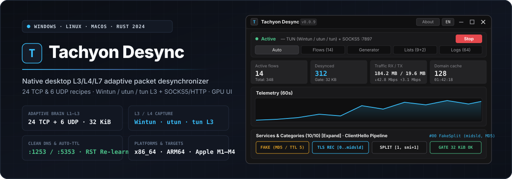
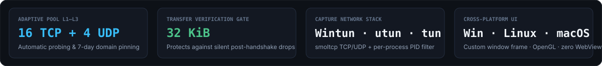
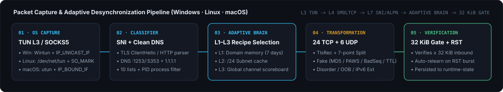

<div align="center">

<p>
  <a href="README.md"></a>
  <a href="README.en.md"></a>
</p>



<p>
  <a href="https://github.com/Dushnilin/tachyon-desync/releases/latest"></a>
  
  
  
  
  <a href="LICENSE"></a>
</p>

<p>
  <strong>Native cross-platform desktop suite for adaptive traffic delivery, TLS record fragmentation, and L3/L4/L7 packet desynchronization across Windows, any Linux distribution, and any macOS system.</strong><br>
  Three-tier <code>AdaptiveBrain L1–L3</code> selector (24 TCP + 6 UDP recipes) · <code>32 KiB</code> inbound verification gate · virtual <code>Wintun / utun / tun L3</code> adapter with userspace <code>smoltcp</code> stack · per-process PID filtering · Clean DNS (<code>:1253</code> / <code>:5353</code>) · Auto-TTL calibration · custom hardware-accelerated <code>OpenGL</code> window frame with zero WebView2 or browser processes.
</p>

<p>
  <a href="#quick-start--prebuilt-binaries">Quick Start</a> ·
  <a href="#key-capabilities--interface">Capabilities</a> ·
  <a href="#desynchronization-pipeline--24-recipes">L1–L3 Recipes</a> ·
  <a href="#capture-modes--per-process-routing">TUN L3 &amp; Process Filter</a> ·
  <a href="#building-from-source">Build</a>
</p>

</div>

<p align="center">
  
</p>

<p align="center">
  
</p>

---

<p align="center">
  
</p>

## Key Capabilities & Interface

**Tachyon Desync** pairs a low-level L3/L4/L7 packet transformation engine with a lightweight, hardware-accelerated desktop UI in a disciplined `Graphite Dark` palette:

- **Custom Window Frame & Hardware Rendering (`OpenGL / glow`)**: rendered directly on the GPU without OS titlebar chrome — featuring custom vector-painted window controls (`—`, `□`, `✕`), titlebar drag, double-click maximize/restore, 8-edge/corner resize handles, an **About** modal, instant **`RU` / `EN`** language switching, and background tray operation.
- **Three-Tier `AdaptiveBrain L1–L3` Selector**:
  - **`L1` (Domain Memory, 7-day TTL)**: immediately applies the verified winning recipe for a known hostname (`SNI` / `Host`) from persistent `runtime-state.json`.
  - **`L2` (`/24` Subnet Cache)**: when connecting to a new subdomain hosted on an already learned `/24` IPv4 prefix, reuses the subnet's winning recipe without probing overhead.
  - **`L3` (Global Channel Scoreboard)**: ranks all 24 TCP recipes using integer `RecipeStats` (success probability + `EWMA RTT`) and passive `IspFingerprint` path profiling.
- **`32 KiB` Verification Gate & Silent-Drop Protection**: a candidate recipe is promoted to `L1`/`L2` only after verified application payload transfer (both on live streams with `256 KiB` promotion and `active_elapsed` idle subtraction, and via pipelined 1-RTT `TLS 1.3` `> 32 KiB` probing in the Generator and Constructor). Consecutive `TCP RST` bursts automatically trigger background re-probing.
- **Clean DNS & Local `hosts` Overrides**: built-in UDP resolver queries non-standard ports (`77.88.8.8:1253`, `208.67.222.222:5353`) alongside `1.1.1.1` and `8.8.8.8`, while the local `hosts` editor binds `domain=IP` directly inside the engine without touching `/etc/hosts` or `C:\Windows\System32\drivers\etc\hosts`.
- **Strategy Generator, Auto-TTL Calibration & `ClientHello` Visualizer**:
  - One-click `> 32 KiB` probing across all 24 reference recipes for any target domain with `RTT ms` measurement, automatic deep combination search, and named custom profiles.
  - Active `Auto-TTL` hop discovery (`2..10` hops) to find the exact minimum TTL that reaches transit middleboxes without reaching the destination server.
  - Interactive `TLS ClientHello` slice diagram (`SNI`, `SLD`, `midsld`, `endhost`, 7-point `Split`, `TlsRec`, `Fake`) and live JSON configuration preview.
- **10 Built-in Service Categories & Per-Process Routing**: curated domain/CIDR lists with per-list `UDP ports` and `UDP TTL` (YouTube, Discord, Telegram, AI Platforms, Streaming, Gaming, Development, Domestic Direct), domain-list priority over built-in game/anticheat bypass, one-click process picker, and optional upstream proxy chaining (`SOCKS5://` or `HTTP://`).

| UI Tab | Purpose & Controls |
| :--- | :--- |
| **`Auto`** | Four summary metric cards (`Active flows`, `Desynced`, `Traffic RX/TX`, `Domain cache`), 60-second telemetry chart, Clean DNS & local `hosts` controls, one-click 6-service `> 32 KiB` health check, 10-category service grid, pinned domain table, and `AdaptiveBrain` cache reset. |
| **`Flows`** | Live monitor of active and recent TCP/UDP flows showing process name, target domain/IP, applied recipe, RX/TX byte counters, and quick actions to send a domain to the Generator or bypass list (`Direct`). |
| **`Generator`** | Automated 24-recipe per-domain `> 32 KiB` probing, `Auto-TTL` hop calibration (`2..10` hops), visual `ClientHello` offset inspector, named profiles, cache reset, and custom profile builder (`Split`, `TlsRec`, `Fake`, `Disorder`, `OOB`, `wsize` / `scale`, `IPv6 Ext`, `QUIC`). |
| **`Lists`** | Per-application process filter and list priority over game bypass, per-process strategy overrides, upstream proxy chaining (`SOCKS5/HTTP`), full JSON backup export/import, and editor for all 10 domain/subnet lists (`UDP ports`, `UDP TTL`). |
| **`Logs`** | Collapsible `L3` channel scoreboard across all 24 recipes, category filter (`desync`, `tun`, `proxy`, `quic`, `probe`, `system`), click-to-copy log rows, and full log export to clipboard. |

---

<p align="center">
  
</p>

## Desynchronization Pipeline & 24 Recipes

In **`Auto (24 recipes)`** mode, the engine inspects the first outbound payload (`TLS ClientHello` or `HTTP Request`), computes semantic markers (`pos 1`, `sni_ext`, `host_start`, `sld_start`, `midsld`, `sld_end`, `host_end`), and executes one of 24 TCP recipes or 6 UDP/QUIC recipes:

| ID | Recipe Name | Wire-Level Transformation |
| :---: | :--- | :--- |
| **`#00`** | `FakeSplit (midsld, MD5 ClientHello clone)` | TLS record split + fake `ClientHello` clone with `TCP MD5` (`Opt 19`) and TCP split at `midsld`. |
| **`#01`** | `TlsRec + Split (SNI TLS record split without fake)` | Pure two-layer TLS record and TCP segment fragmentation at `midsld` with zero fake packets. |
| **`#02`** | `FakeSplit + TlsRec (midsld, PAWS Timestamp, max.ru)` | Fake packet masked as `max.ru` with shifted `TCP Timestamp` (`-600,000` ticks, RFC 7323 PAWS) + `midsld` split. |
| **`#03`** | `FakeDisorder (midsld, MD5, vk.com)` | Out-of-order segment delivery around `midsld` paired with a `vk.com` fake (`TCP MD5`). |
| **`#04`** | `FakeDisorder + TlsRec (midsld, BadSeq -10000, rzd.ru)` | Out-of-order delivery with TLS record splitting and an `rzd.ru` fake carrying a `-10,000` `TCP Sequence Number` offset. |
| **`#05`** | `IPv6 HopByHop2 + FakeSplit (midsld, fonts.google.com)` | Prepends `IPv6 Hop-by-Hop × 2` extension headers + `fonts.google.com` fake and `midsld` split. |
| **`#06`** | `MultiSplit [2, sni_ext, host, midsld] + TlsRec` | 4-point `ClientHello` slicing combined with TLS record fragmentation and zero fake packets. |
| **`#07`** | `FakeSplit AutoTTL (SNI boundary, gosuslugi.ru)` | Dynamic hop-based `AutoTTL` calculation + `SNI` boundary split masked with `gosuslugi.ru`. |
| **`#08`** | `MultiDisorder [2, sni_ext, host, midsld] (MD5, vk.com)` | Multi-point out-of-order delivery of 4 `ClientHello` segments with `TCP MD5` and `vk.com` decoy. |
| **`#09`** | `Disorder (1st-byte AutoTTL + retransmit)` | Isolates the initial TLS byte with `AutoTTL` and out-of-order main segment delivery via `RFC 5681`. |
| **`#10`** | `7-Point MultiDisorder (Md5BadAck + rndsni)` | 7-point out-of-order slicing with combined `Md5BadAck` fooling and randomized decoy `SNI`. |
| **`#11`** | `HostFakeSplit Disorder (in-band host slice, Md5BadAck, rzd.ru)` | Sandwiches the target hostname between two `rzd.ru` decoy segments (`Md5BadAck`) with out-of-order delivery. |
| **`#12`** | `FakeDisorder (BadAck -66000 + PadEncap + seqovl=8)` | `-66,000` `ACK` offset, `PadEncap` framing, and `seqovl=8` sequence overlap. |
| **`#13`** | `7-Point MultiDisorder (BadSeq+BadAck+BadSum, ozon.ru)` | 7-point `MultiDisorder` with triple L4 header modification (`BadSeq + BadAck + BadSum`) and `ozon.ru` decoy. |
| **`#14`** | `FakeSplit DataNoAck (PSH without ACK + sniext+1 + seqovl=12)` | `DataNoAck` segment (`PSH` without `ACK`), `sniext+1` split, and `seqovl=12` overlap (`aws.amazon.com`). |
| **`#15`** | `HostFakeSplit Disorder (AutoTTL, max.ru template)` | Combines `HostFakeSplit` and `Disorder` with adaptive `AutoTTL` and `max.ru` decoy profile. |
| **`#16`** | `OOB Urgent (MSG_OOB + urgent pointer at midsld)` | Pure `TCP MSG_OOB` (`URG`) urgent byte injection directly at the `midsld` split offset without fakes. |
| **`#17`** | `Disoob + TlsRec (out-of-order MSG_OOB at host+1 + wsize=64)` | Combines out-of-order delivery, `MSG_OOB` urgent byte at `host+1`, TLS record split, and `wsize=64` window clamping. |
| **`#18`** | `MultiSplit + SeqOvl=210 (pure segment overlap, no fakes)` | Multi-point segmentation with `seqovl=210` sequence overlap and zero fake packet injection. |
| **`#19`** | `FakeSplit sni_del (SNI-stripped clone + DataNoAck + seqovl=16)` | Structurally identical `ClientHello` clone with stripped `SNI` extension, `DataNoAck`, `sniext+1`, and `seqovl=16`. |
| **`#20`** | `MultiDisorder bin_noise (binary decoy + triple L4)` | Non-TLS `0x0F0F0F0F` binary decoy payload paired with `BadSeq + BadAck + BadSum`. |
| **`#21`** | `FakeDisorder SYNData (SYN decoy + Md5BadAck + PadEncap)` | `SYN`-phase decoy payload (`Linux SOCK_RAW`) or `PadEncap + seqovl=10` with `Md5BadAck`. |
| **`#22`** | `FakeSplit + TlsRec + wsize=64 (host+1, BadSum, ya.ru)` | `wsize=64` receive-window clamping during handshake + TLS record split and `host+1` `BadSum` decoy. |
| **`#23`** | `MultiDisorder + wsize=1:scale=1 (midsld, AutoTTL + sni_del)` | Out-of-order slicing at `midsld` paired with pre-connect `wsize=1`, `TCP Window Scale = 1`, `AutoTTL`, and an `SNI`-stripped clone. |

For **UDP / QUIC** and voice datagrams, 6 dedicated recipes are applied automatically (`#0..#5`: `QUIC Initial` decoy bursts, 24-byte pseudo-random `opaque` datagrams with `udplen` padding, `IPv6 HopByHop` headers, and stepped `TTL 2..5`), along with instant `QUIC UDP/443 -> TCP/TLS` fallback via `ICMP Port Unreachable`.

---

## Capture Modes & Per-Process Routing

`Tachyon Desync` supports 3 capture modes across **Windows, any Linux distribution, and any macOS system** (switchable live from the top bar):

| Platform | `TUN Adapter (L3)` Mode | `System Proxy (:7897)` Mode | Process Discovery (PID) & Autostart |
| :--- | :--- | :--- | :--- |
| **Windows 10 / 11** (`x86_64`) | Embedded **`Wintun`** driver (`10.255.0.1/24`), `0.0.0.0/1` & `128.0.0.0/1` split routes, loop-free outbound socket binding via `IP_UNICAST_IF`. | Automatic `WinINet` proxy configuration (`HKCU\...\Internet Settings`) with local subnet bypass. | `GetExtendedTcpTable` / `GetExtendedUdpTable` (`iphlpapi.dll`), `HKCU\...\Run` autostart, `Shell_NotifyIconW` system tray, `UAC` privilege elevation. |
| **Linux (Any Distro)** (`x86_64`, `aarch64`) | Kernel **`/dev/net/tun`** interface (`10.255.0.1/24`), loop-free routing via `SO_MARK = 0x2022` and `ip rule fwmark 0x2022 lookup 202`. | Desktop proxy configuration via `gsettings` (`127.0.0.1:7897`). | `/proc/net/{tcp,tcp6,udp,udp6}` + `/proc/<pid>/fd` socket inode matching, XDG `~/.config/autostart/tachyon-desync.desktop`, `pkexec` / `CAP_NET_ADMIN`. |
| **macOS 11+** (`Apple Silicon M1–M4`, `Intel x86_64`) | Kernel **`utun`** control socket (`PF_SYSTEM` / `com.apple.net.utun_control`), `0.0.0.0/1` & `128.0.0.0/1` routes, outbound physical interface binding via `IP_BOUND_IF`. | Automatic `networksetup` proxy configuration (`Wi-Fi` / `Ethernet` -> `127.0.0.1:7897`). | Socket and process resolution via `lsof -nP` and `ps`, `~/Library/LaunchAgents/io.tachyon.desync.plist` autostart, `osascript` privilege prompt. |

---

<p align="center">
  
</p>

## Quick Start & Prebuilt Binaries

Download the prebuilt package for your platform from **[GitHub Releases](https://github.com/Dushnilin/tachyon-desync/releases/latest)**:

| Operating System | Architecture | Release Asset | Installation & Launch Notes |
| :--- | :--- | :--- | :--- |
| **Windows 10 / 11** | `x86_64` | `tachyon-desync-windows-amd64.exe`<br>`tachyon-desync-windows-amd64.zip` | Standalone `.exe` with embedded `Wintun` driver. For `TUN` mode, run as Administrator (or click the **`UAC`** button in the top bar). |
| **Linux (Ubuntu / Debian / Mint / Kali)** | `x86_64`<br>`ARM64` | `tachyon-desync_amd64.deb`<br>`tachyon-desync_arm64.deb` | Install via `sudo dpkg -i tachyon-desync_amd64.deb`. Automatically grants `cap_net_admin,cap_net_raw+eip` to `/usr/bin/tachyon-desync` and installs a desktop launcher. |
| **Linux (Any Distro: Arch, Fedora, NixOS, Alpine, etc.)** | `x86_64`<br>`ARM64` | `tachyon-desync-linux-amd64.tar.gz`<br>`tachyon-desync-linux-arm64.tar.gz` | Extract the binary and grant network capabilities: `sudo setcap cap_net_admin,cap_net_raw+eip ./tachyon-desync` (or run with `sudo ./tachyon-desync`). |
| **macOS 11+ (Universal: Apple Silicon & Intel)** | `Universal` (`M1–M4` + `x86_64`) | `tachyon-desync-macos-universal.dmg` | Open the `.dmg` and drag **`Tachyon Desync.app`** to `/Applications`. Prompts for administrator privileges via macOS dialog when activating `utun`. |
| **macOS 11+ (Standalone Binaries)** | `ARM64` (`M1–M4`)<br>`Intel` (`x86_64`) | `tachyon-desync-macos-arm64.tar.gz`<br>`tachyon-desync-macos-amd64.tar.gz` | Standalone native `tachyon-desync` binaries for terminal or script execution. |

### Command-Line Flags & Hotkeys

- `tachyon-desync --minimized` (or `--tray`) — starts minimized in the background and automatically activates packet capture (used when **Autostart** is enabled).
- **`Ctrl + Alt + D`** — global hotkey to toggle packet capture on or off from any window.
- **Configuration & state files** are stored next to the executable in `data/`:
  - `data/config.json` — capture mode, UI language (`ru` / `en`), domain/subnet lists, selected processes, local `hosts` overrides, and custom generator profile;
  - `data/runtime-state.json` — persistent `AdaptiveBrain` state (`L1` domain pins, `L2` `/24` subnet cache, `L3` recipe scoreboard).

---

## Building from Source

Requires **Rust 1.85+** (`2024 Edition`):

```bash
# Run unit tests and build the release binary (Windows / Linux / macOS)
cargo test
cargo build --release
```

On Linux (Ubuntu / Debian), install the windowing and OpenGL development headers before building:

```bash
sudo apt-get install -y pkg-config libx11-dev libxcb-render0-dev libxcb-shape0-dev \
  libxcb-xfixes0-dev libxkbcommon-dev libwayland-dev libgl1-mesa-dev libegl1-mesa-dev
```

---

## Tachyon Ecosystem

- **[Dushnilin/tachyon-desync](https://github.com/Dushnilin/tachyon-desync)** — cross-platform desktop L3/L4/L7 adaptive packet desynchronizer (`Windows` / `Linux` / `macOS`).
- **[Dushnilin/tachyon-core](https://github.com/Dushnilin/tachyon-core)** — high-performance pure-Rust proxy core for OpenWrt routers and Linux servers.
- **[Dushnilin/tachyon-lists](https://github.com/Dushnilin/tachyon-lists)** — automated domain and IP subnet routing lists.

---

## Support the Project

If Tachyon is useful in your infrastructure or daily workflow, you can support ongoing development:

- **Boosty:** [boosty.to/tachyon](https://boosty.to/tachyon)
- **Russian Cards & SBP (CloudTips):** [pay.cloudtips.ru/p/449c5ef9](https://pay.cloudtips.ru/p/449c5ef9)
- **Bitcoin (BTC):** `bc1q9ehdv7y9g948jejyflkq7xmau3tytgunxgh35h`
- **Ethereum (ETH / ERC-20):** `0x6CB7a4547eD62EF64990D5C6B5D9fdA58EB223E6`
- **TON:** `UQDPhLRjMz5KltDLACAT3YXXHDVEtIDOHky2i33ZIOtsMEoR`
- **Solana (SOL):** `3csTGaNeU9KjhCKHEKAU3XLS5UfVjEeBVhXihpsETZwh`

---

## License & Legal Notice

**Tachyon Desync** is distributed as prebuilt executable binaries under the proprietary **[TACHYON DESYNC BINARY LICENSE v1.0](LICENSE)** (`Copyright (c) 2026 Dushnilin. All rights reserved.`):

- You are granted a free license to download, install, and run unmodified official release binaries for personal non-commercial use and internal network infrastructure operations.
- **Redistribution, repackaging, bundling into third-party installers or packages, commercial use, sale, reverse engineering, modification, creation of derivative works, or removal of copyright notices is strictly prohibited** without prior written permission from the copyright holder.

**Disclaimer:**

1. **Purpose of the Software.** `Tachyon Desync` is a general-purpose technical networking utility designed for network connection diagnostics, adaptive packet delivery, traffic routing, and information security.
2. **Compliance with Applicable Laws.** The Software was not created, is not intended, and is not distributed for the purpose of violating the laws of the Russian Federation (including Federal Law No. 149-FZ) or any other jurisdiction, nor for obtaining unauthorized access to restricted information resources.
3. **Use at Your Own Risk.** The author and copyright holder do not provide any proxy/VPN servers, network nodes, subscriptions, access keys, or communication services. The Software is provided `"AS IS"` without warranty of any kind. Any installation, configuration, and operation of the Software is performed by the user strictly on their own initiative, at their own risk, and under their sole responsibility. The copyright holder assumes no liability for user actions, configurations, or any consequences arising from the use of the Software.
