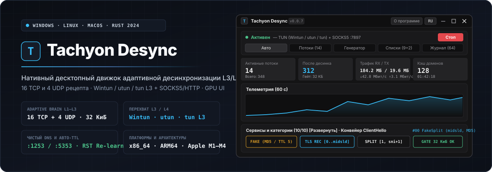
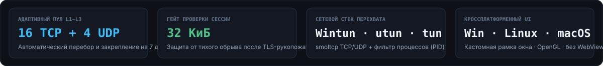
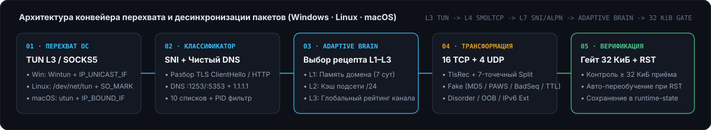

<div align="center">

<p>
  <a href="README.md"></a>
  <a href="README.en.md"></a>
</p>



<p>
  <a href="https://github.com/Dushnilin/tachyon-desync/releases/latest"></a>
  
  
  
  
  <a href="LICENSE"></a>
</p>

<p>
  <strong>Нативный кроссплатформенный десктопный комплекс адаптивной доставки трафика, фрагментации TLS-записей и пакетной десинхронизации L3/L4/L7 для Windows, любого Linux и любого macOS.</strong><br>
  Трёхуровневый селектор <code>AdaptiveBrain L1–L3</code> (16 TCP + 4 UDP рецепта) · гейт верификации <code>32 КиБ</code> · виртуальный адаптер <code>Wintun / utun / tun L3</code> со стеком <code>smoltcp</code> · фильтрация по процессам (PID) · чистый DNS (<code>:1253</code> / <code>:5353</code>) · авто-калибровка TTL · собственная рамка окна на <code>OpenGL</code> без WebView2 и браузерных процессов.
</p>

<p>
  <a href="#быстрый-старт-и-готовые-сборки">Быстрый старт</a> ·
  <a href="#ключевые-возможности-и-интерфейс">Возможности</a> ·
  <a href="#конвейер-десинхронизации-и-16-рецептов">Рецепты L1–L3</a> ·
  <a href="#режимы-перехвата-и-маршрутизация-по-процессам">TUN L3 и процессы</a> ·
  <a href="#сборка-из-исходного-кода">Сборка</a>
</p>

</div>

<p align="center">
  
</p>

<p align="center">
  
</p>

---

<p align="center">
  
</p>

## Ключевые возможности и интерфейс

**Tachyon Desync** объединяет низкоуровневый движок пакетной десинхронизации с компактным графическим интерфейсом в инструментальной графитовой палитре (`Graphite Dark`):

- **Собственная рамка окна (`Custom Window Frame`) и аппаратный рендеринг (`OpenGL / glow`)**: окно рисуется напрямую видеокартой без системных декораций ОС — с векторными кнопками управления (`—`, `□`, `✕`), перетаскиванием за заголовок, разворачиванием по двойному клику, изменением размера за любую из 8 граней, окном **«О программе» (`About`)**, мгновенным переключением языков **`RU` / `EN`** и сворачиванием в системный трей.
- **Трёхуровневый селектор `AdaptiveBrain L1–L3`**:
  - **`L1` (память домена, TTL 7 суток)**: мгновенно применяет проверенный рабочий рецепт для конкретного хоста (`SNI` / `Host`) из энергонезависимого кэша `runtime-state.json`.
  - **`L2` (память подсети `/24`)**: если новый поддомен обращается к уже известной серверной подсети `/24`, автоматически подставляет рецепт этой подсети без лишнего перебора.
  - **`L3` (глобальный рейтинг канала)**: ранжирует все 16 рецептов по экспоненциально затухающему счёту успешных передач на текущем провайдере.
- **Контрольный гейт `32 КиБ` и защита от тихого сброса сессии**: рецепт признаётся рабочим и закрепляется за доменом только после того, как удалённый сервер реально передал не менее `32 КиБ` данных в ответ (исключает ложные срабатывания при обрыве соединения сразу после `ServerHello`). При серии сбросов (`TCP RST`) запускается автоматическое фоновое переобучение.
- **Чистый DNS и локальный `hosts`**: встроенный резолвер запрашивает A-записи через нестандартные порты (`77.88.8.8:1253`, `208.67.222.222:5353`) и резервные публичные узлы (`1.1.1.1`, `8.8.8.8`), а встроенный редактор локального `hosts` позволяет жёстко привязывать `домен=IP` без модификации системного файла `/etc/hosts` или `C:\Windows\System32\drivers\etc\hosts`.
- **Генератор стратегий, авто-калибровка TTL и визуализатор `ClientHello`**:
  - Активный перебор 8 эталонных рецептов для любого домена в один клик с измерением задержки (`RTT ms`).
  - Поиск минимального пробивающего `Auto-TTL` в диапазоне хопов `2..10` до целевого узла без доставки фейкового сегмента конечному серверу.
  - Пошаговая диаграмма нарезки `TLS ClientHello` (`SNI`, `SLD`, `midsld`, `endhost`, 7-точечный `Split`, `TlsRec`, `Fake`) и живой предпросмотр JSON-конфигурации.
- **10 преднастроенных категорий и маршрутизация по процессам**: готовые списки доменов и подсетей (YouTube, Discord, Telegram, ИИ-платформы, стриминг, игровые сервисы, разработка, внутренние ресурсы), выбор процессов в один клик и поддержка каскадной пересылки через внешний прокси (`SOCKS5://` или `HTTP://`).

| Вкладка интерфейса | Назначение и инструменты |
| :--- | :--- |
| **`Авто` (`Auto`)** | Сводные карточки (`Активные потоки`, `После десинка`, `Трафик RX/TX`, `Кэш доменов`), 60-секундный график телеметрии, настройка Чистого DNS и локального `hosts`, проверка доступности 6 сервисов в один клик, свёрнутая по умолчанию панель 10 категорий и таблица закреплённых доменов. |
| **`Потоки` (`Flows`)** | Живой монитор активных и недавних TCP/UDP сессий с отображением процесса, целевого домена/IP, применённого рецепта, счётчиков приёма/отдачи и кнопками быстрой отправки домена в Генератор или в список исключений (`Прямое`). |
| **`Генератор` (`Generator`)** | Автоматический подбор рецепта для выбранного домена, калибровка оптимального `Auto-TTL` (`2..10` хопов), диаграмма разрезов `ClientHello` и полный конструктор пользовательского профиля (`Split`, `TlsRec`, `Fake`, `Disorder`, `OOB`, `IPv6 Ext`, `QUIC`). |
| **`Списки` (`Lists`)** | Управление фильтрацией по процессам (`Все кроме выбранных` / `Только выбранные`), индивидуальная привязка стратегии к процессу, настройка внешнего каскадного прокси (`Upstream SOCKS5/HTTP`), экспорт/импорт полного бэкапа и редактирование 10 списков доменов/CIDR. |
| **`Журнал` (`Logs`)** | Сворачиваемый рейтинг 16 рецептов на канале (`L3 Scoreboard`), фильтрация событий по категориям (`desync`, `tun`, `proxy`, `quic`, `probe`, `system`), копирование любой строки по клику и выгрузка журнала в буфер обмена. |

---

<p align="center">
  
</p>

## Конвейер десинхронизации и 16 рецептов

При установке соединения в режиме **`Авто (16 рецептов)`** движок анализирует первое исходящее сообщение (`TLS ClientHello` или `HTTP Request`), вычисляет семантические смещения внутри пакета (`pos 1`, `sni_ext`, `host_start`, `sld_start`, `midsld`, `sld_end`, `host_end`) и применяет один из 16 рецептов TCP или 4 рецептов UDP/QUIC:

| ID | Название рецепта | Техника трансформации на линии |
| :---: | :--- | :--- |
| **`#00`** | `FakeSplit (midsld, MD5 клон ClientHello)` | Дробление TLS-записи + 2 фейковых клона `ClientHello` с заголовком `TCP MD5` (`Opt 19`) и `TTL=5` + разрез по середине SLD (`midsld`). |
| **`#01`** | `TlsRec + Split (разрез по SNI без фейка)` | Чистая двухэтапная фрагментация записи TLS и TCP-сегмента по смещению `midsld` без инъекции фейковых пакетов (не зависит от фильтрации по TTL). |
| **`#02`** | `FakeSplit + TlsRec (PAWS Timestamp, max.ru)` | Фейковый пакет с маскировкой под `max.ru` и сдвигом `TCP Timestamp` (`-600 000` тиков, отбрасывается сервером по RFC 7323 PAWS) + разрез по `midsld`. |
| **`#03`** | `FakeDisorder (midsld, MD5, vk.com)` | Внепорядочная отправка второго сегмента (`midsld..end`) перед первым в сопровождении фейка `vk.com` с опцией `TCP MD5` и `TTL=6`. |
| **`#04`** | `FakeDisorder + TlsRec (BadSeq -10000, rzd.ru)` | Внепорядочная отправка с двойным дроблением TLS-записи и фейковым пакетом `rzd.ru` со сдвигом `TCP Sequence Number` на `-10 000`. |
| **`#05`** | `IPv6 HopByHop2 + FakeSplit (fonts.google.com)` | Добавление заголовков расширения IPv6 (`Hop-by-Hop × 2`) + фейк `fonts.google.com` (`MD5` + `BadSeq`) и разрез по `midsld`. |
| **`#06`** | `OOB + TlsRec + FakeSplit (Urgent Pointer)` | Сегментация с отправкой байта срочных данных (`TCP MSG_OOB` / `URG`) + дробление TLS-записи и фейк `MD5`. |
| **`#07`** | `HostFakeSplit (midsld, ya.ru, MD5 + TTL 5)` | Изоляция доменного имени внутри `SNI` между двумя фейковыми сегментами `ya.ru` (`MD5`, `TTL=5`) с отправкой реального `SNI` двумя частями. |
| **`#08`** | `MultiSplit 7-точечный + TlsRec (без фейка)` | Семиточечная нарезка `ClientHello` (`pos 1`, `sni+1`, `host+1`, `sld`, `midsld`, `sld_end-2`, `endhost`) без фейковых пакетов. |
| **`#09`** | `FakeDisorder (pos 1 + midsld, TTL 4)` | Низкий `TTL=4` в сочетании с `TCP MD5` и внепорядочной отправкой от второго байта заголовка TLS (`pos 1`). |
| **`#10`** | `TlsRec Multi + Disorder (pos 2 + sni_ext)` | Многократное дробление TLS-записи с внепорядочной доставкой по границе расширения `SNI` без использования фейков. |
| **`#11`** | `HostFakeSplit + TlsRec (sberbank.ru, PAWS)` | Изоляция `SNI` с маскировкой под `sberbank.ru` и устаревшим штампом времени `PAWS Timestamp (-600 000)`. |
| **`#12`** | `FakeSplit (pos 1 + midsld, BadSum + MD5)` | Комбинированная отправка фейкового клона `ClientHello` с заведомо некорректной контрольной суммой L4 (`BadSum`) и `TCP MD5`. |
| **`#13`** | `IPv6 DestOpt + Disorder + TlsRec (gosuslugi.ru)` | Расширение `IPv6 Destination Options` + внепорядочная доставка сегментов и фейк `gosuslugi.ru` (`PAWS` + `BadSeq`). |
| **`#14`** | `FakeSplit + OOB (midsld, TTL 7, gosuslugi.ru)` | Дальнобойный `TTL=7` для протяжённых магистральных маршрутов + байт `TCP OOB` и разрез по середине домена второго уровня. |
| **`#15`** | `HostFakeSplit + Disorder (rutube.ru, MD5 + BadSeq)` | Полная комбинация `HostFakeSplit`, внепорядочной доставки (`Disorder`), дробления TLS-записи и двойного фейка `rutube.ru`. |

Для протокола **UDP / QUIC** и голосовых датаграмм автоматически применяются 4 специализированных рецепта (`#0` 4 фейковых датаграммы `QUIC Initial` с `TTL=5`; `#1` 6 фейков с `TTL=4` и стартовым `0x00`; `#2` 8 фейков с `TTL=6` + `IPv6 HopByHop`; `#3` 2 коротких `0xFF`-фейка с `TTL=3`), а для браузерного трафика поддерживается принудительный перевод `QUIC UDP/443 -> TCP/TLS`.

---

## Режимы перехвата и маршрутизация по процессам

`Tachyon Desync` поддерживает 3 режима работы на **Windows, любом дистрибутиве Linux и любой версии macOS** (переключаются на лету из шапки окна):

| Платформа | Режим `Адаптер TUN (L3)` | Системный прокси (`:7897`) | Определение процессов (PID) и Автозапуск |
| :--- | :--- | :--- | :--- |
| **Windows 10 / 11** (`x86_64`) | Встроенный драйвер **`Wintun`** (`10.255.0.1/24`), маршруты `0.0.0.0/1` и `128.0.0.0/1`, привязка исходящих сокетов через `IP_UNICAST_IF`. | Автоматическая настройка `WinINet` (`HKCU\...\Internet Settings`) с исключением локальных подсетей. | Таблицы `GetExtendedTcpTable` / `GetExtendedUdpTable` (`iphlpapi.dll`), реестр `HKCU\...\Run`, системный трей `Shell_NotifyIconW`, повышение привилегий через `UAC`. |
| **Linux (любой дистрибутив)** (`x86_64`, `aarch64`) | Ядерный интерфейс **`/dev/net/tun`** (`10.255.0.1/24`), защита от петель через `SO_MARK = 0x2022` и таблицу маршрутизации `ip rule fwmark 0x2022 lookup 202`. | Настройка системного прокси окружения рабочего стола через `gsettings` (`127.0.0.1:7897`). | Чтение сокетов из `/proc/net/{tcp,tcp6,udp,udp6}` и дескрипторов `/proc/<pid>/fd`, XDG-автозапуск `~/.config/autostart/tachyon-desync.desktop`, запрос прав через `pkexec` / `CAP_NET_ADMIN`. |
| **macOS 11+** (`Apple Silicon M1–M4`, `Intel x86_64`) | Системный сокет **`utun`** (`PF_SYSTEM` / `com.apple.net.utun_control`), маршруты `0.0.0.0/1` и `128.0.0.0/1`, привязка исходящих сокетов к физическому интерфейсу через `IP_BOUND_IF`. | Автоматическая настройка `networksetup` (`Wi-Fi` / `Ethernet` -> `127.0.0.1:7897`). | Сопоставление открытых портов и процессов через `lsof -nP` и `ps`, агент автозапуска `~/Library/LaunchAgents/io.tachyon.desync.plist`, запрос прав через `osascript`. |

---

<p align="center">
  
</p>

## Быстрый старт и готовые сборки

Скачайте подходящую сборку со страницы **[GitHub Releases](https://github.com/Dushnilin/tachyon-desync/releases/latest)**:

| Операционная система | Архитектура | Файл релиза | Примечание по установке и запуску |
| :--- | :--- | :--- | :--- |
| **Windows 10 / 11** | `x86_64` | `tachyon-desync-windows-amd64.exe`<br>`tachyon-desync-windows-amd64.zip` | Автономный `.exe` со встроенным драйвером `Wintun`. Для режима `TUN` запустите от имени Администратора (или нажмите кнопку **`UAC`** в шапке окна). |
| **Linux (Ubuntu / Debian / Mint / Kali)** | `x86_64`<br>`ARM64` | `tachyon-desync_amd64.deb`<br>`tachyon-desync_arm64.deb` | Установка: `sudo dpkg -i tachyon-desync_amd64.deb`. Пакет автоматически назначает `cap_net_admin,cap_net_raw+eip` на `/usr/bin/tachyon-desync` и добавляет ярлык в меню приложений. |
| **Linux (Любой дистрибутив: Arch, Fedora, NixOS, Alpine и др.)** | `x86_64`<br>`ARM64` | `tachyon-desync-linux-amd64.tar.gz`<br>`tachyon-desync-linux-arm64.tar.gz` | Распакуйте бинарный файл и выдайте права на сетевой стек: `sudo setcap cap_net_admin,cap_net_raw+eip ./tachyon-desync` (или запускайте через `sudo ./tachyon-desync`). |
| **macOS 11+ (Universal: Apple Silicon & Intel)** | `Universal` (`M1–M4` + `x86_64`) | `tachyon-desync-macos-universal.dmg` | Откройте `.dmg` и перетащите **`Tachyon Desync.app`** в папку `/Applications`. Для активации `utun` приложение запросит права администратора через стандартное окно macOS. |
| **macOS 11+ (Отдельные бинарники)** | `ARM64` (`M1–M4`)<br>`Intel` (`x86_64`) | `tachyon-desync-macos-arm64.tar.gz`<br>`tachyon-desync-macos-amd64.tar.gz` | Архивы с нативным исполняемым файлом `tachyon-desync` для запуска из терминала или собственных скриптов. |

### Параметры командной строки и горячие клавиши

- `tachyon-desync --minimized` (или `--tray`) — запуск в фоновом режиме (в системном трее) с автоматическим стартом перехвата; используется при включении галочки **«Автозапуск»**.
- **`Ctrl + Alt + D`** — глобальная комбинация клавиш для мгновенного запуска или остановки перехвата из любого окна.
- **Файлы состояния и конфигурации** создаются автоматически рядом с исполняемым файлом в каталоге `data/`:
  - `data/config.json` — выбранный режим перехвата, язык интерфейса (`ru` / `en`), списки доменов/подсетей, выбранные процессы, локальный `hosts` и пользовательский профиль генератора;
  - `data/runtime-state.json` — обученная память `AdaptiveBrain` (`L1` домены, `L2` подсети `/24`, `L3` счётчики рецептов).

---

## Сборка из исходного кода

Требуется установленный тулчейн **Rust 1.85+** (`2024 Edition`):

```bash
# Сборка и запуск тестов (Windows / Linux / macOS)
cargo test
cargo build --release
```

На Linux (Ubuntu / Debian) перед сборкой установите заголовки графической подсистемы:

```bash
sudo apt-get install -y pkg-config libx11-dev libxcb-render0-dev libxcb-shape0-dev \
  libxcb-xfixes0-dev libxkbcommon-dev libwayland-dev libgl1-mesa-dev libegl1-mesa-dev
```

---

## Экосистема Tachyon

- **[Dushnilin/tachyon-desync](https://github.com/Dushnilin/tachyon-desync)** — десктопный комплекс адаптивной пакетной десинхронизации L3/L4/L7 (`Windows` / `Linux` / `macOS`).
- **[Dushnilin/tachyon-core](https://github.com/Dushnilin/tachyon-core)** — высокопроизводительное прокси-ядро на чистом Rust для маршрутизаторов OpenWrt и серверов Linux.
- **[Dushnilin/tachyon-lists](https://github.com/Dushnilin/tachyon-lists)** — автоматически обновляемые списки доменов и IP-подсетей маршрутизации.

---

## Поддержать разработку

Если Tachyon помогает в работе, вы можете поддержать развитие проекта:

- **Boosty:** [boosty.to/tachyon](https://boosty.to/tachyon)
- **Карты РФ и СБП (CloudTips):** [pay.cloudtips.ru/p/449c5ef9](https://pay.cloudtips.ru/p/449c5ef9)
- **Bitcoin (BTC):** `bc1q9ehdv7y9g948jejyflkq7xmau3tytgunxgh35h`
- **Ethereum (ETH / ERC-20):** `0x6CB7a4547eD62EF64990D5C6B5D9fdA58EB223E6`
- **TON:** `UQDPhLRjMz5KltDLACAT3YXXHDVEtIDOHky2i33ZIOtsMEoR`
- **Solana (SOL):** `3csTGaNeU9KjhCKHEKAU3XLS5UfVjEeBVhXihpsETZwh`

---

## Лицензия и правовая информация

Программное обеспечение **Tachyon Desync** распространяется в виде готовых исполняемых сборок на условиях проприетарной лицензии **[TACHYON DESYNC BINARY LICENSE v1.0](LICENSE)** (`Copyright (c) 2026 Dushnilin. All rights reserved.`):

- Разрешается бесплатная загрузка, установка и использование неизменённых официальных бинарных сборок в личных некоммерческих целях и во внутренней сетевой инфраструктуре.
- **Запрещается** копирование, переупаковка, повторное распространение в составе сторонних сборок или пакетов, коммерческое использование, продажа, декомпиляция, модификация, создание производных продуктов или удаление уведомлений об авторских правах без предварительного письменного разрешения правообладателя.

**Отказ от ответственности:**

1. **Назначение программного обеспечения.** `Tachyon Desync` является универсальным техническим средством диагностики сетевых соединений, адаптивной доставки пакетов, маршрутизации сетевого трафика и обеспечения информационной безопасности.
2. **Соблюдение законодательства.** Программное обеспечение не создавалось, не предназначено и не распространяется для целей нарушения законодательства Российской Федерации (включая ФЗ № 149-ФЗ «Об информации, информационных технологиях и о защите информации») или законодательства любой иной юрисдикции, а равно для неправомерного получения доступа к информационным ресурсам, доступ к которым ограничен в соответствии с законом.
3. **Использование на собственный страх и риск.** Автор и правообладатель не предоставляют никаких прокси/VPN-серверов, узлов связи, подписок, ключей доступа или услуг связи. Программное обеспечение поставляется по принципу «КАК ЕСТЬ» (`AS IS`). Любая установка, настройка и эксплуатация программы осуществляются пользователем исключительно по собственной инициативе, на свой страх и риск и под свою полную единоличную ответственность. Правообладатель не несёт ответственности за действия пользователя, выбранные им конфигурации и любые последствия использования программного обеспечения.
